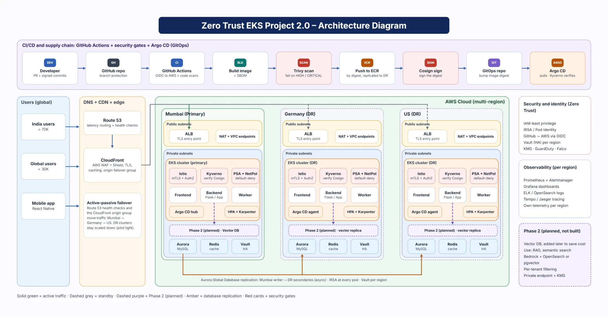

# Architecture: Zero Trust EKS Project 2.0

This file maps every box in the diagram to the roadmap phase that builds it and the code that
implements it. "Built" means the Terraform is written and validates. Nothing is applied until you
run it yourself.

## Status per diagram box

| Diagram box | Phase | Status | Where |
|---|---|---|---|
| **CI/CD:** Developer, signed commits, branch protection | 2 | Planned | GitHub settings, `.github/` |
| GitHub Actions: OIDC to AWS, code scans | 0 / 2 | Plan role + static checks built | `bootstrap/`, `.github/workflows/terraform-checks.yml` |
| Build image + SBOM, Trivy (fail on HIGH/CRITICAL) | 2 | Built | `.github/workflows/backend-image.yml`, `apps/backend` |
| Push to ECR by digest, replicated to DR | 2 / 7 | Built (replication + Cosign key replica switched on for the drill) | `environments/shared/supply-chain` |
| Cosign sign the digest | 2 | Built (KMS key, sign + SBOM attestation) | workflow + `supply-chain/signing.tf`, ADR 0005 |
| GitOps repo bump digest, Argo CD pull | 2 | Built (digest bump as a PR) | `gitops/`, `environments/dev/platform/argocd.tf` |
| **Users:** India, global, mobile | 4 / 5 | n/a (traffic) | n/a |
| Route 53 latency routing + health checks | 5 | Planned | `environments/global/edge` |
| CloudFront + WAF + Shield, origin failover group | 5 | Planned | `environments/global/edge` |
| **Mumbai VPC:** public subnets, ALB, NAT, VPC endpoints | 1 | Built | `modules/vpc`, `environments/dev/network` |
| EKS cluster (primary), private subnets | 1 | Built | `modules/eks`, `environments/dev/eks` |
| HPA + Karpenter | 1 | Built (metrics-server, Karpenter, NodePool) | `environments/dev/platform` |
| IRSA / Pod Identity | 1 | Built (Pod Identity, OIDC provider for IRSA) | `modules/eks`, ADR 0004 |
| ALB entry point (AWS Load Balancer Controller) | 1 | Built | `environments/dev/platform` |
| Argo CD hub (DR clusters run agents) | 2 | Built (hub in dev; agents in Phase 7) | `environments/dev/platform/argocd.tf` |
| Istio mTLS + AuthZ | 3 | Planned | `gitops/` |
| Kyverno verify Cosign | 3 | Planned | `gitops/`, `policies/` |
| PSA + NetworkPolicy default-deny | 3 | PSA `restricted` on backend namespace built; NetworkPolicy planned | `gitops/workloads/backend/overlays/dev/namespace.yaml` |
| Vault (HA) per region | 3 | Planned (not in roadmap before this diagram) | `gitops/` |
| KMS, GuardDuty, Falco | 1 / 5 / 3 | KMS built (state, EKS secrets) | `bootstrap/`, `modules/eks` |
| Frontend, Backend (Flask), Worker | 4 | Backend skeleton built in Phase 2; rest planned | `apps/`, `gitops/workloads/` |
| Aurora MySQL | 4 | Planned | `modules/aurora` |
| Redis cache | 4 | Planned | `modules/redis` |
| Observability: Prometheus, Alertmanager, Grafana, OpenSearch, Tempo/Jaeger | 6 | Planned | `gitops/` |
| Germany (DR) region, pilot light (US dropped, ADR 0010) | 7 | Built as code, not applied | `environments/dev/*` in the `dr` workspace, `scripts/up-dr.sh` |
| Aurora Global Database (Mumbai writer, Frankfurt headless secondary) | 7 | Built as code, not applied | `environments/dev/data`, `scripts/dr-drill.sh` |
| Vector DB / RAG | 9 | Built as code, not applied (pgvector chosen) | `apps/backend/rag.py`, `migrate.py`, ADR 0011 |

## Open decision: one or two DR regions

The diagram shows two DR regions (Germany and US). ADR 0003 says one lean DR region, with a third
only if data residency or user location justifies it. Each extra region roughly doubles the DR cost
(EKS control plane, NAT, Aurora secondary). Recommendation: build Germany as the DR region in
Phase 7 and keep US as a documented, code-ready option that you apply only for a demo.

## Added after the diagram: Forward Deployed Engineer (FDE) track

Not a box in the diagram but a goal of the project: show how an engineer embedded with a customer
would use this platform. Proposed content (to confirm): a customer problem statement and discovery
notes, onboarding a customer as a tenant, a customer-facing RAG use case on the vector DB, and a
demo, runbook and handover pack.

## Differences from the diagram (on purpose)

- **Dev first, single region.** Only Mumbai dev exists until Phase 7 (ADR 0003, cost).
- **One NAT gateway in dev** instead of one per AZ (`single_nat_gateway = true`). Prod sets false.
- **Interface VPC endpoints are off in dev** (about $6/day for ECR, STS, SSM, logs across 3 AZs).
  The free S3 gateway endpoint is on. Prod sets `interface_endpoints`.
